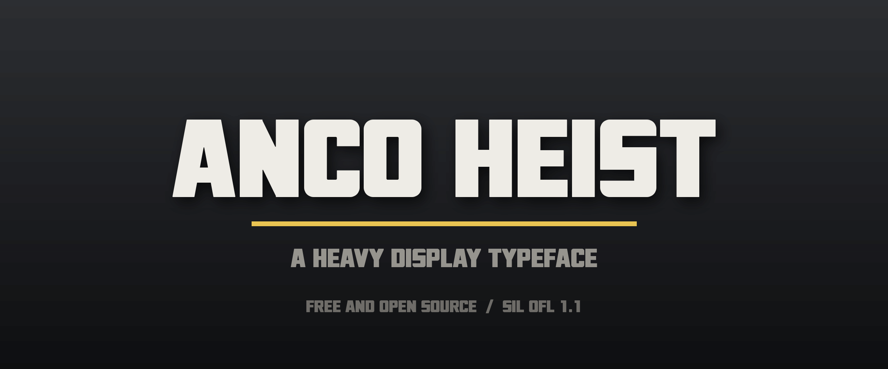
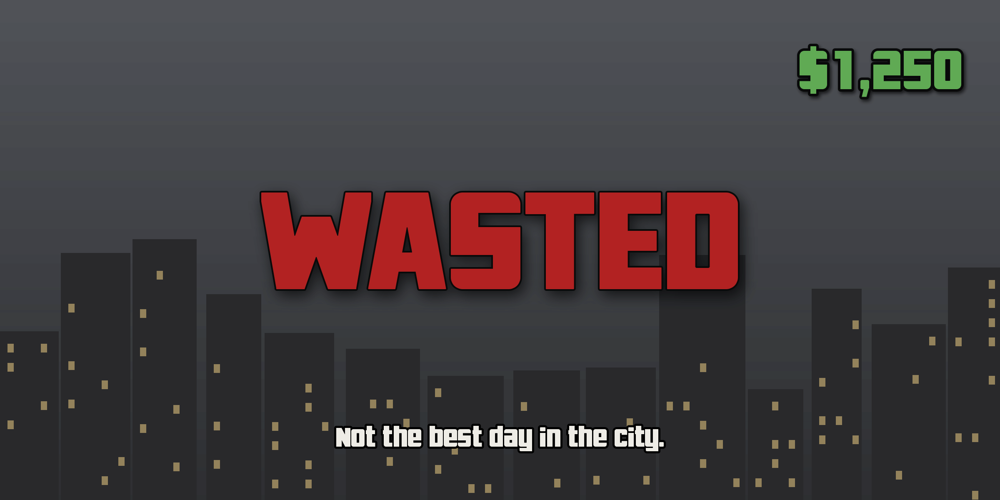
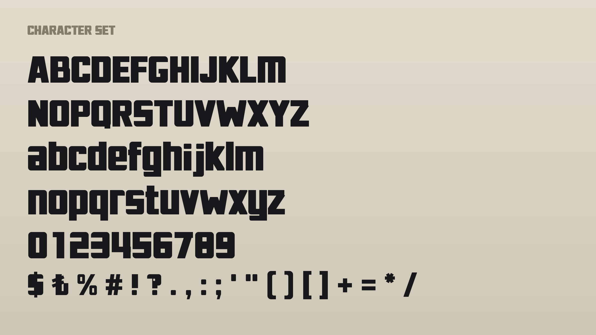
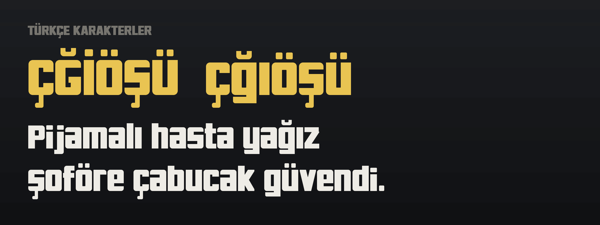
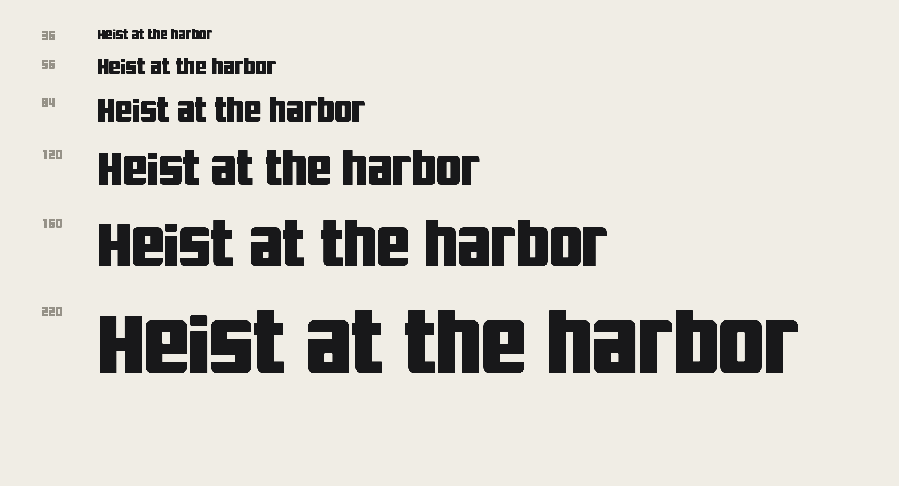

# Anco Heist

A heavy, boxy display typeface with a retro game-title character. Free and open source under the SIL Open Font License 1.1.



## A note on where this comes from

Grand Theft Auto IV has been a constant presence in my life. Few works have shaped my taste as deeply, and its visual language, the weight and confidence of its lettering in particular, has stayed with me for years.

Anco Heist is my tribute to that feeling. It is not a copy of any existing typeface. Every glyph was drawn from scratch in code, and the goal was never to reproduce a specific font, but to capture the same sense of weight, density and attitude in a design of my own.

This project is independent and is not affiliated with, endorsed by, or connected to Rockstar Games or Take-Two Interactive. Grand Theft Auto is a trademark of Take-Two Interactive Software, Inc.

## Character set



- Latin capitals and lowercase, A to Z
- Tabular figures 0 to 9
- Full Turkish support: Ç Ğ İ Ö Ş Ü ç ğ ı ö ş ü
- Punctuation and symbols: `. , : ; ! ? ' " ( ) [ ] + = * / \ # % $ ₺`





## Download

Get the latest fonts from the [Releases](../../releases/latest) page, or take them straight from the `fonts/` folder:

| Format | File | Use |
|---|---|---|
| TTF | `fonts/ttf/AncoHeist-Black.ttf` | Desktop apps, design tools |
| OTF | `fonts/otf/AncoHeist-Black.otf` | Desktop apps, print |
| WOFF2 | `fonts/webfonts/AncoHeist-Black.woff2` | Websites |

## Use on the web

Self-hosted:

```css
@font-face {
  font-family: "Anco Heist";
  src: url("/fonts/AncoHeist-Black.woff2") format("woff2");
  font-weight: 900;
  font-display: swap;
}

h1 { font-family: "Anco Heist", sans-serif; }
```

Or from a CDN, with no download (replace `USER` with the GitHub username and `v1.0` with a release tag):

```css
src: url("https://cdn.jsdelivr.net/gh/USER/ancoHeist@v1.0/fonts/webfonts/AncoHeist-Black.woff2") format("woff2");
```

## How it is built

The letters are drawn in Python from simple shapes (rectangles, rounded boxes, slanted strokes) combined with boolean operations, then compiled into font files.

```
scripts/tuning.py    design dials: heights, stroke weights, corner radii, spacing
scripts/glyphs.py    one function per glyph
scripts/shapes.py    shape helpers and corner softening
scripts/generate.py  glyphs.py -> sources/AncoHeist-Black.ufo (plus kerning and font info)
scripts/build.sh     UFO -> TTF, OTF, WOFF2
scripts/showcase.py  renders the images in this README
test/index.html      live type tester
```

Change a value in `tuning.py`, rebuild, and the whole alphabet follows.

```bash
python3 -m venv .venv && source .venv/bin/activate
pip install -r requirements.txt
python scripts/generate.py
./scripts/build.sh
python scripts/showcase.py        # optional, refreshes the images
python -m http.server             # then open http://localhost:8000/test/
```

The UFO in `sources/` can also be opened in [Fontra](https://fontra.xyz) or FontForge for hand editing. After hand edits, run only `build.sh`, since `generate.py` overwrites the UFO.

## License

The font and its source are released under the [SIL Open Font License 1.1](OFL.txt). You may use it freely in personal and commercial work, modify it and redistribute it. The only restriction is that the font files may not be sold on their own.

Designed by Mehmet Esat Çömlekçi ([ancoesat.dev](https://ancoesat.dev)).
